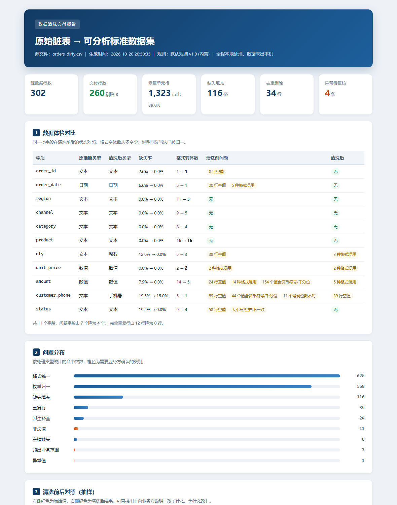

# data-clean-pipeline

> 本地文件级数据清洗 · 脏表进、标准数据集出 · 每一个改动都有留痕

面向「Excel / CSV 导出表太脏，没法直接分析」的场景：字段格式不统一、一列里混着五种日期写法、金额带 ¥ 和千分位、同一条记录被重复上报、必填项空着。本工具把它洗成可直接入库/建模的标准数据集，并出一份客户能看懂的清洗报告。

**全程本地处理，文件不出本机，不连任何云数据库。**

**跑出来长这样**（真实运行产物截图，非示意图）：



👉 **[在线打开真 HTML 清洗报告](https://mming-liu.github.io/data-clean-pipeline/)** — 可逐节翻阅、可直接打印 PDF，与截图同源，由项目自身生成

---

## 零、操作步骤（照着敲，约 3 分钟）

> 命令按 **Windows cmd** 写。macOS / Linux 把 `python` 换成 `python3`，`copy` 换成 `cp`，路径换成 `/你的路径/data-clean-pipeline`。

### 步骤 1｜确认 Python 可用

```bat
python --version
```

期望 `Python 3.8` 及以上（实测 3.13.12）。提示找不到命令时改用 `py -3 --version`。

### 步骤 2｜进入项目目录

```bat
cd /d C:\myFloders\git\data-clean-pipeline
```

必须在这个目录下执行，因为 `clean.py` 要用同级的 `pipeline/` 包；漏掉的典型报错是 `ModuleNotFoundError: No module named 'pipeline'`。

### 步骤 3｜跑演示（自带脏数据，无需准备文件）

```bat
python clean.py --demo
```

约 1 秒，输出：

```
[1/4] 读取 orders_dirty.csv：302 行 × 11 列
      体检完成，发现 7 个字段存在问题
[2/4] 按规则清洗
      修复 1323 个单元格，去重 34 行，剔除 8 行，标记异常 4 条
[3/4] 写出交付文件
[4/4] 生成 HTML 清洗报告
```

倒数第二行是机器可读汇总，可直接粘进验收单：

```json
{"src_rows": 302, "out_rows": 260, "deduped_rows": 34, "total_fixes": 1323}
```

### 步骤 4｜打开产物看结果

| 顺序 | 文件 | 能看到什么 |
| --- | --- | --- |
| ① | `out\clean_report.html` | **建议先开这个**：清洗前后体检对比、问题分布、逐格修复明细、待复核清单 |
| ② | `out\clean_dataset.csv` | 交付用的标准数据集：日期统一 `YYYY-MM-DD`、金额为纯数字、手机号 11 位 |
| ③ | `out\issues.csv` | 逐格留痕：第几行第几列、原值、问题类型、处理动作、结果——可下钻到具体单元格 |
| ④ | `out\rejected.csv` | 8 行不满足必填约束的记录，带剔除原因，单独出库不混入交付 |
| ⑤ | `out\profile_before.json` / `profile_after.json` | 清洗前后数据体检快照，适合发给客户确认口径 |
| ⑥ | `out\stats.json` | 处理统计，供二次核验 |

打开方式：`start out\clean_report.html`。

### 步骤 5｜跑自测

```bat
python -m unittest discover -s tests -v
```

期望结尾：

```
Ran 15 tests in 0.02s

OK
```

其中包含「随机脏数据行数守恒」压测：源行数必须等于交付 + 剔除 + 去重，一次都不能差。

### 步骤 6｜换成自己的数据

```bat
:: 1) 先按内置默认规则试跑一遍，看体检结果和剔除原因
python clean.py --input raw\orders_dirty.csv --out-dir 试跑

:: 2) 复制规则模板，按客户口径改（枚举映射、必填项、填充策略都在里面）
copy rules.example.json rules.json
notepad rules.json

:: 3) 用改好的规则正式跑，产物进独立目录，便于比对
python clean.py --input raw\orders_dirty.csv --rules rules.json --out-dir 交付_v1
```

不传 `--rules` 就用内置默认规则；`--out-dir` 不传则默认写 `out\`（会覆盖 demo 产物，正式交付建议每次给新目录，如 `交付_v1`、`交付_v2`）。

### 步骤 7｜验收时怎么核（三句话讲清）

1. **行数守恒**，一条命令自查：

```bat
python -c "import json;d=json.load(open('out\\stats.json',encoding='utf-8'));print(d['src_rows'],'=',d['out_rows'],'+',d['rejected_rows'],'+',d['deduped_rows'],'->',d['src_rows']==d['out_rows']+d['rejected_rows']+d['deduped_rows'])"
```

输出 `302 = 260 + 8 + 34 -> True` 即通过。

2. **没丢数据**：随便挑一行没进交付集的，都能在 `rejected.csv` 或 `issues.csv` 里查到原因。
3. **可追溯**：`issues.csv` 里每一格都有原值与处理结果，客户质疑某条数据时能当场定位。

### 步骤 8｜出问题先查这张表

| 现象 | 原因 | 处理 |
| --- | --- | --- |
| `ModuleNotFoundError: No module named 'pipeline'` | 不在项目根目录执行 | 先 `cd /d` 到含 `clean.py` 的目录 |
| `文件不存在：xxx` | `--input` 路径写错 | 用相对 `raw\` 的路径，或写绝对路径并加引号 |
| `无法识别文件编码：xxx` | 文件既不是 UTF-8 也不是 GBK（如 UTF-16） | Excel 另存为「CSV UTF-8」后重跑 |
| 中文显示乱码 | 控制台代码页不是 UTF-8 | 先 `chcp 65001` |
| 清洗后某列全是空 | `rules.json` 里的枚举映射没覆盖客户的取值 | 打开 `profile_before.json` 看该列实际取值，补进映射表；未命中值会被置空并列入待确认 |
| 交付行数比预期少很多 | 去重键选得太宽（如只按日期） | 检查 `rules.json` 的 `dedupe.keys`，一般用业务主键如 `order_id` |

## 一、产物说明（跑完你会看到什么）

自动生成一份 302 行的「真实风格脏表」，清洗后输出到 `out/`：

| 文件 | 说明 |
| --- | --- |
| `clean_dataset.csv` | 交付用的标准数据集 |
| `rejected.csv` | 不满足必填约束的行（单独出库，不混入交付、也不静默删除） |
| `issues.csv` | 逐格留痕：哪一行、哪一列、原值、问题类型、处理动作、结果 |
| `clean_report.html` | 清洗报告：体检对比、问题分布、前后对照、待复核清单 |
| `profile_before.json` / `profile_after.json` | 清洗前后数据体检快照 |
| `stats.json` | 机器可读的处理统计 |

demo 数据实际结果：**302 行 → 交付 260 行**（去重 34、剔除 8），修复 **1323** 个单元格，标记 6 条异常待复核。所有数字在报告里可逐条下钻到行。

## 二、处理能力

| 类别 | 具体规则 |
| --- | --- |
| 文本归一 | 全角空格、零宽字符、换行、首尾空白、连续多空格 |
| 日期统一 | `2026-07-05` / `2026/7/5` / `2026.07.05` / `20260705` / `2026年7月5日` / 带时分秒 / Excel 序列号 → 统一 `YYYY-MM-DD` |
| 金额数值 | 去 `¥ ￥ 元`、千分位逗号、括号负数，统一两位小数 |
| 数量整数 | 去「件/个」等单位，小数四舍五入 |
| 手机号 | 去 `-`、空格、`+86` 前缀，校验 11 位与号段，位数不足直接判非法 |
| 枚举归一 | 中英文混用、带「区/类/旗舰店」后缀、大小写不一致 → 标准取值；未命中映射的值置空并单列待确认 |
| 缺失填充 | 中位数 / 众数 / 固定默认值 / 前值填充 / 保留原样，按列配置 |
| 派生补全 | 如 `amount = qty * unit_price`，只允许列名与四则运算，表达式白名单求值 |
| 异常检测 | IQR×3 离群标记 + 业务区间校验（如 `qty ∈ [1, 5000]`），**只标记不删数据** |
| 去重 | 按业务主键去重，保留字段最全的一条；主键为空的行不参与去重，交必填校验处理 |
| 必填校验 | 不满足约束的行单独出 `rejected.csv`，附剔除原因 |

## 三、三条质量底线（写进交付验收标准）

1. **行数守恒**：`源行数 = 交付行数 + 剔除行数 + 去重行数`，误差为 0。测试里有随机脏数据压测这条不变式。
2. **不静默丢数据**：任何一行没进交付集，都能在 `rejected.csv` 或 `issues.csv` 找到原因。
3. **可追溯**：`issues.csv` 精确到「第几行第几列、原值是什么、变成了什么」，出问题能回滚判断。

## 四、规则配置化：改口径不用改代码

`rules.example.json` 是完整规则示例，复制成 `rules.json` 后按客户口径改：

```bash
python clean.py --input raw/orders_dirty.csv --rules rules.json --out-dir 交付_v1
```

可配置项：类型化字段清单、枚举映射表、缺失填充策略、派生表达式、去重键与保留策略、异常检测参数、业务区间、必填约束。

**这也是投标里最实用的一点**：开工前把 `profile_before.json` 发给客户，逐条确认「这个空值填什么、这个异常值算不算数」，规则落定后再跑，避免返工扯皮。

## 五、目录结构

```
data-clean-pipeline/
├── clean.py                  # CLI 入口
├── pipeline/
│   ├── rules.py              # 解析原语：日期/数值/手机号/枚举/安全表达式
│   ├── cleaner.py            # 清洗主流程（8 步，顺序有讲究）
│   ├── profile.py            # 数据体检与前后对比
│   └── report.py             # HTML 报告渲染
├── demo/make_dirty_data.py   # 脏数据生成器（可重复）
├── tests/test_rules.py       # 15 条测试，含行数守恒压测
├── rules.example.json        # 规则模板
├── raw/                      # 原始脏数据
└── out/                      # 交付产物
```

## 六、环境要求

- Python 3.8+（实测 3.13），**零第三方依赖**，可完全断网运行
- 输入支持 UTF-8（含 BOM）与 GBK 编码的 CSV

## 七、边界说明

- 本 demo 以 CSV 为交付格式。需要直接读写 `.xlsx` 时，生产版接 `openpyxl`（随包提供离线 whl，客户无需联网）。
- 「异常值」默认只标记不修改，因为业务上「大额订单」可能是真的大单。是否截断/删除由客户在规则里决定。
- 不承接云端数据库直连清洗，符合「本地文件级、数据不出本机」的服务定位。

---

## 八、同系列仓库（可串成一条链路）

| 仓库 | 作用 |
| --- | --- |
| [py-automation-kit](https://github.com/mming-liu/py-automation-kit) | 文件与接口层：批量整理、多表合并、接口同步，产出规范 CSV |
| **data-clean-pipeline**（本仓库） | 数据层：脏表 → 标准数据集，逐格留痕可追溯 |
| [offline-analytics-report](https://github.com/mming-liu/offline-analytics-report) | 报表层：标准数据集 → 经营复盘报表与结论 |

本仓库产出的 `out/clean_dataset.csv` 可直接作为项目三的输入：

```bash
python ../offline-analytics-report/analyze.py --input out/clean_dataset.csv
```

---

维护：需求分析师 + 测试与开发工程师 轻量化协作 · 开工前对齐规则，交付时逐条可核
